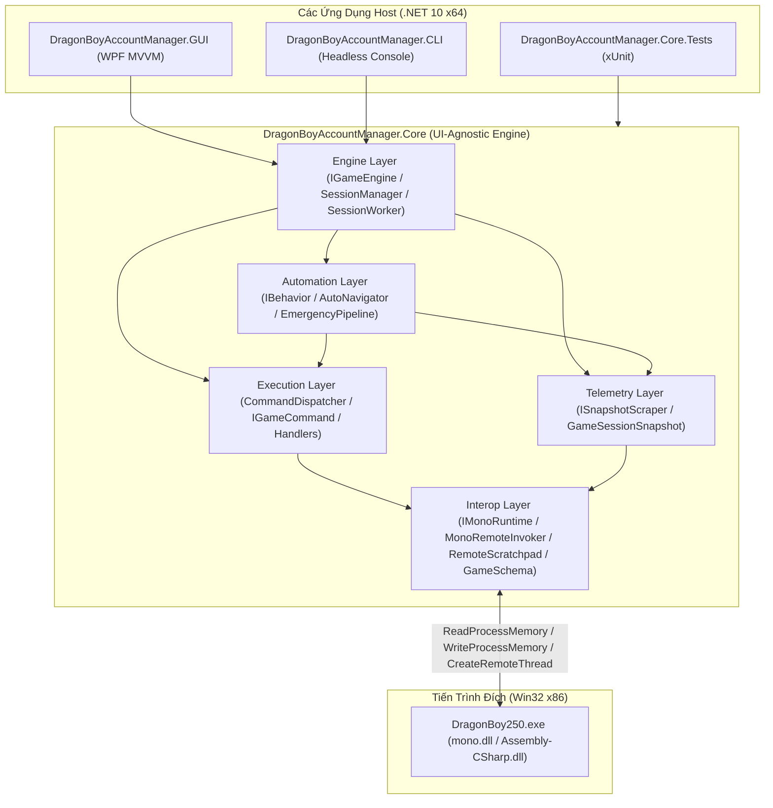

# Tài Liệu Kiến Trúc Giải Pháp DBAM (Solution Architecture)

Tài liệu này mô tả toàn diện kiến trúc giải pháp của **DragonBoyAccountManager (DBAM)** sau khi được tái cấu trúc và tổng quát hóa theo các nguyên tắc **SOLID**, **DRY**, **YAGNI** và **Clean Architecture**.

---

## 1. Danh Mục Tài Liệu Kiến Trúc

| Tài Liệu | Nội Dung Trọng Tâm |
|---|---|
| [`README.md`](file:///d:/DragonBoy/DBAM/docs/README.md) | Tổng quan kiến trúc giải pháp, sơ đồ luồng dữ liệu liên tiến trình và 7 bất biến kỹ thuật cốt lõi. |
| [`core-architecture.md`](file:///d:/DragonBoy/DBAM/docs/core-architecture.md) | Kiến trúc phân hệ [`DragonBoyAccountManager.Core`](file:///d:/DragonBoy/DBAM/src/DragonBoyAccountManager.Core): Interop, Telemetry Snapshot, CQRS Command Pipeline, Pluggable Behaviors và Session Engine. |
| [`gui-architecture.md`](file:///d:/DragonBoy/DBAM/docs/gui-architecture.md) | Kiến trúc phân hệ [`DragonBoyAccountManager.GUI`](file:///d:/DragonBoy/DBAM/src/DragonBoyAccountManager.GUI): Cấu trúc 3 tầng (`Domain`, `Services`, `Presentation`), `IActivatableTab`, `AccountAwareTabViewModel`, Declarative Settings Binding và Retro Pixel Design System. |
| [`extensibility-guide.md`](file:///d:/DragonBoy/DBAM/docs/extensibility-guide.md) | Cẩm nang mở rộng tính năng mới (Scraper, Command, Behavior, GUI Tab, Setting) tuân thủ nguyên tắc Open/Closed (OCP). |

---

## 2. Tổng Quan Hệ Sinh Thái Giải Pháp (`DBAM.slnx`)

Giải pháp [`DBAM.slnx`](file:///d:/DragonBoy/DBAM/DBAM.slnx) chạy trên nền tảng **.NET 10 / C# 13** (Windows x64) để điều khiển và tự động hóa hàng loạt tiến trình game client Unity 5.x 32-bit (`DragonBoy250.exe`) thông qua cơ chế **Out-of-Process Memory I/O & Mono C-API Reflection**:



---

## 3. Bảy Bất Biến Kỹ Thuật Cốt Lõi (Architectural Invariants)

1. **Độc Lập Giao Diện Tuyệt Đối Ở Core (UI-Agnostic Core):**
   - [`DragonBoyAccountManager.Core`](file:///d:/DragonBoy/DBAM/src/DragonBoyAccountManager.Core) hoàn toàn không tham chiếu tới WPF (`System.Windows.*`) hay bất kỳ thư viện giao diện nào. Mọi Host (`GUI`, `CLI`, dịch vụ nền) đều giao tiếp qua [`IGameEngine`](file:///d:/DragonBoy/DBAM/src/DragonBoyAccountManager.Core/Engine/Abstractions/IGameEngine.cs) và dòng sự kiện đa hình [`SessionEvent`](file:///d:/DragonBoy/DBAM/src/DragonBoyAccountManager.Core/Engine/Events/SessionEvents.cs).
2. **Quy Tắc Đồng Bộ 1:1 Thư Mục Và Namespace (1:1 Folder-to-Namespace Alignment):**
   - Mọi tệp `.cs` và `.xaml` trong toàn bộ giải pháp đều có `namespace` khớp chính xác 100% với đường dẫn thư mục vật lý của tệp đó.
3. **Cô Lập Bộ Nhớ Liên Tiến Trình Qua Single Scratchpad Mutex:**
   - Mỗi phiên [`GameSession`](file:///d:/DragonBoy/DBAM/src/DragonBoyAccountManager.Core/Sessions/GameSession.cs) chỉ cấp phát **một vùng nhớ thực thi duy nhất** ([`RemoteScratchpad`](file:///d:/DragonBoy/DBAM/src/DragonBoyAccountManager.Core/Interop/Memory/RemoteScratchpad.cs)) trong tiến trình đích. Mọi lời gọi hàm Mono qua [`MonoRemoteInvoker.Call`](file:///d:/DragonBoy/DBAM/src/DragonBoyAccountManager.Core/Interop/Mono/MonoRemoteInvoker.cs#L26-L76) đều đi qua khóa `WithLock` và tự động đính kèm `mono_thread_attach` / `mono_thread_detach`.
4. **Không Bao Giờ Thực Hiện Syscall Trên Luồng Giao Diện (Zero UI-Thread Syscalls):**
   - Luồng WPF `Dispatcher` trên GUI **tuyệt đối không** gọi trực tiếp `ReadProcessMemory`, `WriteProcessMemory` hay `CreateRemoteThread`. Toàn bộ dữ liệu trạng thái nhân vật, kỹ năng (`SkillList`), quái vật, khu vực và bản đồ đều được thu thập ở luồng nền [`SessionWorker`](file:///d:/DragonBoy/DBAM/src/DragonBoyAccountManager.Core/Engine/SessionWorker.cs) vào các bản ghi Snapshot bất biến ([`GameSessionSnapshot`](file:///d:/DragonBoy/DBAM/src/DragonBoyAccountManager.Core/Telemetry/Snapshots/GameSessionSnapshot.cs)).
5. **Cô Lập Tầng Tự Động Hóa Khỏi `IMonoRuntime` (Strict Layer Isolation):**
   - Giao diện [`ISessionContext`](file:///d:/DragonBoy/DBAM/src/DragonBoyAccountManager.Core/Sessions/ISessionContext.cs) cung cấp cho các [`IBehavior`](file:///d:/DragonBoy/DBAM/src/DragonBoyAccountManager.Core/Automation/Behaviors/IBehavior.cs) **không phơi bày `IMonoRuntime`**. Mọi hành vi tự động hóa bắt buộc phải đọc dữ liệu từ `GetSnapshot<TSnapshot>()` và gửi lệnh qua [`ICommandDispatcher`](file:///d:/DragonBoy/DBAM/src/DragonBoyAccountManager.Core/Execution/ICommandDispatcher.cs).
6. **Tuần Tự Hóa Khởi Động Tiến Trình & File RMS (`_launchGate`):**
   - [`SessionManager.StartSessionAsync`](file:///d:/DragonBoy/DBAM/src/DragonBoyAccountManager.Core/Engine/SessionManager.cs#L88-L98) sử dụng `SemaphoreSlim _launchGate` để bảo vệ đoạn tới hạn từ lúc ghi file cấu hình máy chủ dùng chung (`svselect`) qua [`GameRmsStorage`](file:///d:/DragonBoy/DBAM/src/DragonBoyAccountManager.Core/Sessions/GameRmsStorage.cs) cho tới khi tiến trình game nạp xong `Assembly-CSharp`, ngăn chặn hoàn toàn lỗi nhận nhầm máy chủ khi mở nhiều tài khoản cùng lúc.
7. **Mở Rộng Động Theo Nguyên Tắc Open/Closed (OCP):**
   - Các thành phần cốt lõi của cả Core và GUI đều hoạt động dựa trên cơ chế đăng ký tổng quát (`RegisterScraper<TSnapshot>`, `RegisterHandler<TCommand>`, `RegisterBehavior<TBehavior>`, `IActivatableTab`, `AccountAwareTabViewModel`, `SettingItemViewModel.Bind...`), cho phép thêm tính năng mới mà không cần sửa đổi mã nguồn điều phối hiện có.

---

## 4. Chuẩn Quy Trình Kiểm Chứng

Mọi thay đổi kiến trúc hoặc tính năng trong dự án đều phải vượt qua kiểm tra biên dịch không cảnh báo và toàn bộ bộ kiểm thử đơn vị:

```powershell
dotnet build DBAM.slnx --nologo
dotnet test DBAM.slnx --nologo
```
