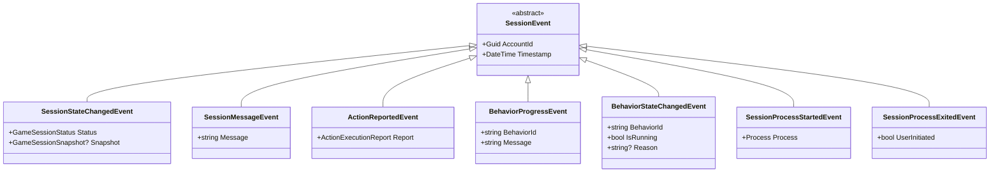

# Kiến Trúc Phân Hệ Core (`DragonBoyAccountManager.Core`)

[`DragonBoyAccountManager.Core`](file:///d:/DragonBoy/DBAM/src/DragonBoyAccountManager.Core) là thư viện nền tảng độc lập giao diện (UI-Agnostic Engine), chịu trách nhiệm giao tiếp bộ nhớ ngoài tiến trình (Out-of-Process), thu thập dữ liệu Telemetry, điều phối lệnh CQRS và vận hành các hành vi tự động hóa.

---

## 1. Cấu Trúc Thư Mục & Phân Tầng (1:1 Namespace)

```text
src/DragonBoyAccountManager.Core/
├── Accounts/                           # Mô hình tài khoản & lưu trữ DPAPI JSON
│   ├── Account.cs
│   ├── AccountAutoSettings.cs          # Cấu hình tự động hóa mở rộng (CustomBehaviors)
│   ├── IAccountStorageService.cs
│   ├── AccountStorageService.cs
│   └── ServerOption.cs
├── Common/                             # Kiểu dữ liệu & tiện ích dùng chung
│   ├── Results/
│   │   ├── Result.cs
│   │   └── ActionExecutionReport.cs
│   ├── ChatType.cs
│   ├── Constants.cs
│   ├── GameKey.cs
│   ├── GameKeyMapper.cs
│   ├── GameSessionStatus.cs
│   └── TextMaskHelper.cs
├── Interop/                            # Giao tiếp Win32 Native & Mono C-API
│   ├── Native/                         # P/Invoke kernel32/user32 & JobObject
│   ├── Memory/                         # ProcessMemory, RemoteScratchpad, x86/x64 Assembler
│   └── Mono/                           # IMonoRuntime, MonoRemoteInvoker, MonoGameExtensions
│       └── Schema/                     # Định nghĩa ánh xạ lớp/trường/phương thức game
│           ├── GameDefinitions.cs
│           ├── GameSchema.System.cs
│           ├── GameSchema.Entities.cs
│           ├── GameSchema.World.cs
│           └── GameSchema.UI.cs
├── Telemetry/                          # Thu thập dữ liệu một chiều (Read-Only Snapshots)
│   ├── Snapshots/
│   │   ├── GameSessionSnapshot.cs      # Túi chứa Snapshot đa hình cho toàn phiên
│   │   ├── PlayerSnapshot.cs           # Thông tin nhân vật, danh sách kỹ năng (SkillList) & hành trang (BagItemList)
│   │   ├── WorldSnapshot.cs            # IPositioned, IWorldEntity, Quái, Boss, NPC, Khu vực
│   │   ├── MapSnapshot.cs              # Dữ liệu bản đồ & ma trận Tile phục vụ tìm đường
│   │   └── ItemSnapshot.cs             # Vật phẩm hành trang, mặt đất và kỹ năng
│   └── Scrapers/
│       ├── ISnapshotScraper.cs         # Giao diện tổng quát ISnapshotScraper<out TSnapshot>
│       ├── PlayerScraper.cs
│       ├── WorldScraper.cs
│       ├── MapScraper.cs
│       └── CollectionHelper.cs
├── Execution/                          # Đường ống thực thi lệnh một chiều (CQRS Write-Only)
│   ├── ICommandDispatcher.cs
│   ├── CommandDispatcher.cs            # Điều phối đa hình có khóa SemaphoreSlim & Middleware
│   ├── ICommandMiddleware.cs
│   ├── GameInputSender.cs
│   ├── Commands/
│   │   ├── IGameCommand.cs
│   │   └── GameCommands.cs
│   ├── Handlers/
│   │   ├── CombatHandler.cs
│   │   ├── MovementHandler.cs
│   │   ├── InteractionHandler.cs
│   │   └── SkillAssignmentHandler.cs
│   └── Middlewares/
│       ├── CommandLoggingMiddleware.cs
│       └── CommandRateLimitMiddleware.cs
├── Automation/                         # Các hành vi tự động hóa & tìm đường A*
│   ├── Behaviors/
│   │   ├── IBehavior.cs                # IBehavior & IBehavior<TOptions>
│   │   ├── AutomationBehavior.cs       # Lớp cơ sở vòng lặp hành vi có giữ ISessionContext
│   │   ├── Combat/
│   │   │   ├── AutoTrainBehavior.cs
│   │   │   └── AutoChatBehavior.cs
│   │   ├── Lifecycle/
│   │   │   └── AutoLoginBehavior.cs
│   │   └── Navigation/
│   │       ├── AutoNavigator.cs
│   │       └── TileAStarFinder.cs
│   └── Interrupters/                   # Ngắt khẩn cấp ưu tiên cao (Hồi sinh, Đậu thần)
│       ├── IInterrupter.cs
│       ├── EmergencyPipeline.cs
│       ├── AutoPeanInterrupter.cs
│       └── AutoReviveInterrupter.cs
├── Sessions/                           # Quản lý vòng đời một phiên tiến trình game
│   ├── ISessionContext.cs              # Giao diện ngữ cảnh phiên (cô lập IMonoRuntime)
│   ├── GameSession.cs                  # Container chứa Scrapers, Dispatcher, Behaviors
│   ├── SessionLauncher.cs
│   ├── LaunchOptions.cs
│   ├── GameRmsStorage.cs
│   ├── Controllers/                    # Bộ điều khiển cấp phiên (LoginScreenController, SessionMaskingController)
│   └── Validation/                     # Kiểm tra tính hợp lệ của client PE/Mono
└── Engine/                             # Điều phối đa phiên & phát sự kiện hợp nhất
    ├── Abstractions/
    │   ├── IGameEngine.cs
    │   ├── ISessionManager.cs
    │   └── GameEngineExtensions.cs
    ├── Events/
    │   └── SessionEvents.cs            # Hệ thống sự kiện đa hình SessionEvent
    ├── Models/
    │   └── AccountLaunchOptions.cs
    ├── GameEngine.cs
    ├── SessionManager.cs
    └── SessionWorker.cs
```

---

## 2. Năm Trụ Cột Tổng Quát Hóa Của Core

### 2.1. Phân Tách `GameSchema` Theo Miền & `MonoGameExtensions`
- Toàn bộ tên lớp, trường và phương thức của `Assembly-CSharp.dll` được quản lý tập trung tại `Interop/Mono/Schema/` và chia thành 4 tệp `partial class GameSchema`:
  - [`GameSchema.System.cs`](file:///d:/DragonBoy/DBAM/src/DragonBoyAccountManager.Core/Interop/Mono/Schema/GameSchema.System.cs): `Main`, `GameCanvas`, `Service`, `Controller`, `Session_ME`, `Rms`, `mSystem`.
  - [`GameSchema.Entities.cs`](file:///d:/DragonBoy/DBAM/src/DragonBoyAccountManager.Core/Interop/Mono/Schema/GameSchema.Entities.cs): `Char`, `Mob`, `MobTemplate`, `Npc`, `NpcTemplate`, `Item`, `ItemMap`, `ItemOption`, `Skill`, `SkillTemplate`.
  - [`GameSchema.World.cs`](file:///d:/DragonBoy/DBAM/src/DragonBoyAccountManager.Core/Interop/Mono/Schema/GameSchema.World.cs): `TileMap`, `Waypoint`, `PopUp`, `MovePoint`, `InfoDlg`.
  - [`GameSchema.UI.cs`](file:///d:/DragonBoy/DBAM/src/DragonBoyAccountManager.Core/Interop/Mono/Schema/GameSchema.UI.cs): `GameScr`, `LoginScr`, `ServerListScreen`, `SplashScr`, `SelectCharScr`, `ChooseCharScr`, `Panel`, `Command`, `TField`, `MyVector`, `MyHashTable`.
- [`MonoGameExtensions.cs`](file:///d:/DragonBoy/DBAM/src/DragonBoyAccountManager.Core/Interop/Mono/MonoGameExtensions.cs) đóng gói các phương thức truy xuất con trỏ Singleton cốt lõi (`GetMyCharPtr()`, `GetServicePtr()`, `GetGameScrPtr()`, `GetGameCanvasPtr()`) dùng chung cho mọi Handler và Scraper.

### 2.2. Đường Ống Telemetry Đa Hình (`ISnapshotScraper<out TSnapshot>`)
- Giao diện [`ISnapshotScraper<out TSnapshot>`](file:///d:/DragonBoy/DBAM/src/DragonBoyAccountManager.Core/Telemetry/Scrapers/ISnapshotScraper.cs) sử dụng Default Interface Implementation cho `SnapshotType` và `Scrape()`, giúp các lớp thực thi ([`PlayerScraper`](file:///d:/DragonBoy/DBAM/src/DragonBoyAccountManager.Core/Telemetry/Scrapers/PlayerScraper.cs), [`WorldScraper`](file:///d:/DragonBoy/DBAM/src/DragonBoyAccountManager.Core/Telemetry/Scrapers/WorldScraper.cs), [`MapScraper`](file:///d:/DragonBoy/DBAM/src/DragonBoyAccountManager.Core/Telemetry/Scrapers/MapScraper.cs)) chỉ cần viết duy nhất phương thức `TSnapshot Scrape()`.
- Trong mỗi chu kỳ [`GameSession.Tick()`](file:///d:/DragonBoy/DBAM/src/DragonBoyAccountManager.Core/Sessions/GameSession.cs#L145-L154), tất cả Scraper đã đăng ký qua `RegisterScraper<TSnapshot>` đều được thực thi và lưu vào từ điển `_snapshots`.
- [`GameSessionSnapshot`](file:///d:/DragonBoy/DBAM/src/DragonBoyAccountManager.Core/Telemetry/Snapshots/GameSessionSnapshot.cs) đóng gói cả `PlayerSnapshot`, `WorldSnapshot`, `MapSnapshot` lẫn toàn bộ `CustomSnapshots`, cho phép truy xuất bất kỳ Snapshot mở rộng nào qua `snapshot.Get<TSnapshot>()`.
- Các thực thể có tọa độ trong thế giới game đều kế thừa [`IPositioned`](file:///d:/DragonBoy/DBAM/src/DragonBoyAccountManager.Core/Telemetry/Snapshots/WorldSnapshot.cs#L3-L7) và [`IWorldEntity`](file:///d:/DragonBoy/DBAM/src/DragonBoyAccountManager.Core/Telemetry/Snapshots/WorldSnapshot.cs#L9-L14), chia sẻ hàm tính khoảng cách Euclidean `DistanceTo(targetX, targetY)` tại [`PositionedExtensions`](file:///d:/DragonBoy/DBAM/src/DragonBoyAccountManager.Core/Telemetry/Snapshots/WorldSnapshot.cs#L16-L24).

### 2.3. Đường Ống Lệnh CQRS Đa Hình (`CommandDispatcher`)
- [`CommandDispatcher`](file:///d:/DragonBoy/DBAM/src/DragonBoyAccountManager.Core/Execution/CommandDispatcher.cs) lưu trữ các handler dưới dạng `ConcurrentDictionary<Type, CommandExecutionDelegate>` và tra cứu theo kiểu thực tế `command.GetType()` lúc chạy.
- Nhờ đó, `DispatchAsync` hỗ trợ đồng thời cả lệnh gọi generic tường minh lẫn lệnh gọi đa hình thông qua giao diện [`IGameCommand`](file:///d:/DragonBoy/DBAM/src/DragonBoyAccountManager.Core/Execution/Commands/IGameCommand.cs) tại [`IGameEngine.ExecuteCommandAsync`](file:///d:/DragonBoy/DBAM/src/DragonBoyAccountManager.Core/Engine/Abstractions/IGameEngine.cs#L20) mà không cần reflection.
- Mọi lệnh thực thi đều đi qua khóa `SemaphoreSlim` (1 lệnh tại 1 thời điểm trên mỗi phiên) và chuỗi middleware [`ICommandMiddleware`](file:///d:/DragonBoy/DBAM/src/DragonBoyAccountManager.Core/Execution/ICommandMiddleware.cs).

### 2.4. Hệ Thống Hành Vi Tự Động Hóa (`IBehavior<TOptions>`)
- [`IBehavior<TOptions>`](file:///d:/DragonBoy/DBAM/src/DragonBoyAccountManager.Core/Automation/Behaviors/IBehavior.cs#L18-L22) và lớp cơ sở [`AutomationBehavior<TOptions>`](file:///d:/DragonBoy/DBAM/src/DragonBoyAccountManager.Core/Automation/Behaviors/AutomationBehavior.cs#L155-L179) chuẩn hóa vòng đời khởi chạy (`StartAsync`), tạm dừng (`Pause`/`Resume`), dừng (`Stop`) và cập nhật cấu hình nóng (`UpdateOptions`) một cách an toàn luồng (`volatile`).
- Trước mỗi nhịp `OnTickAsync`, [`EmergencyPipeline`](file:///d:/DragonBoy/DBAM/src/DragonBoyAccountManager.Core/Automation/Interrupters/EmergencyPipeline.cs) luôn được ưu tiên kiểm tra trước để xử lý tức thời các tình huống sinh tồn ([`AutoReviveInterrupter`](file:///d:/DragonBoy/DBAM/src/DragonBoyAccountManager.Core/Automation/Interrupters/AutoReviveInterrupter.cs), [`AutoPeanInterrupter`](file:///d:/DragonBoy/DBAM/src/DragonBoyAccountManager.Core/Automation/Interrupters/AutoPeanInterrupter.cs)).
- [`SessionWorker`](file:///d:/DragonBoy/DBAM/src/DragonBoyAccountManager.Core/Engine/SessionWorker.cs) hoàn toàn tuân thủ nguyên tắc Open/Closed: không chứa bất kỳ câu lệnh kiểm tra kiểu `if (behavior is ...)` nào mà điều phối đồng nhất mọi Behavior qua `StartBehavior<TBehavior, TOptions>`, `UpdateBehaviorOptions<TBehavior, TOptions>`, `StopBehavior<TBehavior>`.

### 2.5. Dòng Sự Kiện Hợp Nhất (`SessionEvent`)
Toàn bộ thông báo từ `SessionWorker` -> `SessionManager` -> `GameEngine` được hợp nhất vào một luồng sự kiện đa hình duy nhất `event Action<SessionEvent>? OnSessionEvent` tại [`SessionEvents.cs`](file:///d:/DragonBoy/DBAM/src/DragonBoyAccountManager.Core/Engine/Events/SessionEvents.cs):


