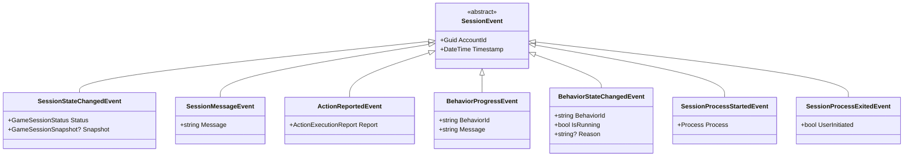

# Kiến Trúc Phân Hệ Core (`DragonBoyAccountManager.Core`)

[`DragonBoyAccountManager.Core`](file:///d:/DragonBoy/DBAM/src/DragonBoyAccountManager.Core) là thư viện nền tảng độc lập giao diện (UI-Agnostic Engine), chịu trách nhiệm giao tiếp bộ nhớ ngoài tiến trình (Out-of-Process), thu thập dữ liệu Telemetry, điều phối lệnh CQRS và vận hành các hành vi tự động hóa.

---

## 1. Cấu Trúc Thư Mục & Phân Tầng (1:1 Namespace)

```text
src/DragonBoyAccountManager.Core/
├── Accounts/                           # Mô hình tài khoản & lưu trữ DPAPI JSON
│   ├── Account.cs
│   ├── AccountAutoSettings.cs          # Cấu hình tự động hóa tổng quát (Behaviors Dictionary)
│   ├── IAccountStorageService.cs
│   ├── AccountStorageService.cs
│   └── ServerOption.cs
├── Common/                             # Kiểu dữ liệu & tiện ích dùng chung
│   ├── Results/
│   │   ├── Result.cs
│   │   └── ActionExecutionReport.cs
│   ├── ChatType.cs
│   ├── Constants.cs
│   ├── GameKey.cs
│   ├── GameKeyMapper.cs
│   ├── GameSessionStatus.cs
│   └── TextMaskHelper.cs
├── Interop/                            # Giao tiếp Win32 Native & IL2CPP Runtime x64
│   ├── Abstractions/                   # IGameRuntime, GameRuntimeExtensions
│   ├── Native/                         # P/Invoke kernel32/user32/psapi & WindowsJobObject
│   ├── Memory/                         # ProcessMemory, RemoteScratchpad, x64 Assembler
│   ├── Execution/                      # RemoteInvoker x64 C-API invocation
│   ├── Il2Cpp/                         # Il2CppRuntime
│   ├── Schema/                         # Định nghĩa ánh xạ lớp/trường/phương thức & RVA
│   │   ├── GameDefinitions.cs
│   │   ├── GameMemoryLayout.cs
│   │   ├── GameSchema.cs
│   │   ├── GameSchema.System.cs
│   │   ├── GameSchema.Entities.cs
│   │   ├── GameSchema.World.cs
│   │   ├── GameSchema.UI.cs
│   │   └── VersionOffsetProvider.cs
│   └── GameRuntimeFactory.cs           # Factory khởi tạo và gắn kết runtime
├── Telemetry/                          # Thu thập dữ liệu một chiều (Read-Only Snapshots)
│   ├── Snapshots/
│   │   ├── GameSessionSnapshot.cs      # Túi chứa Snapshot đa hình cho toàn phiên
│   │   ├── PlayerSnapshot.cs           # Thông tin nhân vật, danh sách kỹ năng (SkillList) & hành trang (BagItemList)
│   │   ├── WorldSnapshot.cs            # IPositioned, IWorldEntity, Quái, Boss, NPC, Khu vực
│   │   ├── MapSnapshot.cs              # Dữ liệu bản đồ & ma trận Tile phục vụ tìm đường
│   │   └── ItemSnapshot.cs             # Vật phẩm hành trang, mặt đất và kỹ năng
│   └── Scrapers/
│       ├── ISnapshotScraper.cs         # Giao diện tổng quát ISnapshotScraper<out TSnapshot>
│       ├── PlayerScraper.cs
│       ├── WorldScraper.cs
│       ├── MapScraper.cs
│       └── CollectionHelper.cs
├── Execution/                          # Đường ống thực thi lệnh một chiều (CQRS Write-Only)
│   ├── ICommandDispatcher.cs
│   ├── CommandDispatcher.cs            # Điều phối đa hình có khóa SemaphoreSlim & Middleware
│   ├── ICommandMiddleware.cs
│   ├── GameInputSender.cs
│   ├── Commands/                       # Phân tách lệnh theo miền nghiệp vụ
│   │   ├── IGameCommand.cs
│   │   ├── CombatCommands.cs
│   │   ├── MovementCommands.cs
│   │   ├── InventoryCommands.cs
│   │   ├── ZoneCommands.cs
│   │   ├── ChatCommands.cs
│   │   └── WorldCommands.cs
│   ├── Handlers/
│   │   ├── CombatHandler.cs
│   │   ├── MovementHandler.cs
│   │   ├── InventoryHandler.cs
│   │   ├── ChatHandler.cs
│   │   ├── WorldInteractionHandler.cs
│   │   ├── ZoneHandler.cs
│   │   └── SkillAssignmentHandler.cs
│   └── Middlewares/
│       ├── CommandLoggingMiddleware.cs
│       └── CommandRateLimitMiddleware.cs
├── Automation/                         # Các hành vi tự động hóa & dịch vụ điều hướng A*
│   ├── Behaviors/
│   │   ├── IBehavior.cs                # IBehavior & IBehavior<TOptions>
│   │   ├── AutomationBehavior.cs       # Lớp cơ sở vòng lặp hành vi có AttachContext(ISessionContext)
│   │   ├── Combat/
│   │   │   ├── AutoTrainBehavior.cs
│   │   │   └── AutoTrainOptions.cs
│   │   ├── Social/
│   │   │   ├── AutoChatBehavior.cs
│   │   │   └── AutoChatOptions.cs
│   │   └── Lifecycle/
│   │       ├── AutoLoginBehavior.cs
│   │       └── AutoLoginOptions.cs
│   ├── Navigation/
│   │   ├── AutoNavigator.cs
│   │   └── TileAStarFinder.cs
│   └── Interrupters/                   # Ngắt khẩn cấp ưu tiên cao (Hồi sinh, Đậu thần)
│       ├── IInterrupter.cs
│       ├── EmergencyPipeline.cs
│       ├── AutoPeanInterrupter.cs
│       └── AutoReviveInterrupter.cs
├── Sessions/                           # Quản lý vòng đời một phiên tiến trình game
│   ├── ISessionContext.cs              # Giao diện ngữ cảnh phiên (cô lập IGameRuntime)
│   ├── GameSession.cs                  # Container tổng quát chứa Scrapers, Dispatcher, Behaviors
│   ├── DefaultSessionBootstrap.cs      # Đăng ký bộ Scrapers, Handlers & Behaviors mặc định
│   ├── ISessionLauncher.cs             # Hợp đồng khởi chạy tiến trình game
│   ├── SessionLauncher.cs              # Thiết lập RMS & khởi chạy tiến trình Dragonboy252.exe
│   ├── LaunchOptions.cs
│   ├── GameRmsStorage.cs
│   ├── Controllers/                    # Bộ điều khiển cấp phiên (LoginScreenController, SessionMaskingController, GameSpeedController)
│   └── Validation/                     # Kiểm tra tính hợp lệ của client PE/IL2CPP
└── Engine/                             # Điều phối đa phiên & phát sự kiện hợp nhất
    ├── Abstractions/
    │   ├── IGameActionService.cs
    │   ├── IGameAutomationService.cs
    │   ├── IGameEngineEvents.cs
    │   ├── IGameEngine.cs
    │   ├── ISessionManager.cs
    │   └── GameEngineExtensions.cs
    ├── Events/
    │   └── SessionEvents.cs            # Hệ thống sự kiện đa hình SessionEvent
    ├── Models/
    │   └── AccountLaunchOptions.cs     # Bao gồm cấu hình AutoReconnect & ReconnectPolicyResolver
    ├── GameEngine.cs                   # Hiện thực IGameEngine & IAsyncDisposable
    ├── SessionManager.cs               # Hiện thực ISessionManager, Auto-Reconnect & IAsyncDisposable
    └── SessionWorker.cs                # Quản lý luồng vòng đời phiên, IAsyncDisposable
```

---

## 2. Năm Trụ Cột Tổng Quát Hóa Của Core

### 2.1. Phân Tách `GameSchema` Theo Miền & `GameRuntimeExtensions`
- Toàn bộ tên lớp, trường, phương thức và RVA offsets của `GameAssembly.dll` được quản lý tập trung tại `Interop/Schema/` (và `Offsets.json`) chia thành 4 tệp `partial class GameSchema`:
  - [`GameSchema.System.cs`](file:///d:/DragonBoy/DBAM/src/DragonBoyAccountManager.Core/Interop/Schema/GameSchema.System.cs): `Main`, `GameCanvas`, `Service`, `Controller`, `Session_ME`, `Rms`, `mSystem`.
  - [`GameSchema.Entities.cs`](file:///d:/DragonBoy/DBAM/src/DragonBoyAccountManager.Core/Interop/Schema/GameSchema.Entities.cs): `Char`, `Mob`, `MobTemplate`, `Npc`, `NpcTemplate`, `Item`, `ItemMap`, `ItemOption`, `Skill`, `SkillTemplate`.
  - [`GameSchema.World.cs`](file:///d:/DragonBoy/DBAM/src/DragonBoyAccountManager.Core/Interop/Schema/GameSchema.World.cs): `TileMap`, `Waypoint`, `PopUp`, `MovePoint`, `InfoDlg`.
  - [`GameSchema.UI.cs`](file:///d:/DragonBoy/DBAM/src/DragonBoyAccountManager.Core/Interop/Schema/GameSchema.UI.cs): `GameScr`, `LoginScr`, `ServerListScreen`, `SplashScr`, `SelectCharScr`, `ChooseCharScr`, `Panel`, `Command`, `TField`, `MyVector`, `MyHashTable`.
- [`GameRuntimeExtensions.cs`](file:///d:/DragonBoy/DBAM/src/DragonBoyAccountManager.Core/Interop/Abstractions/GameRuntimeExtensions.cs) đóng gói các phương thức truy xuất con trỏ Singleton cốt lõi (`GetMyCharPtr()`, `GetServicePtr()`, `GetGameScrPtr()`, `GetGameCanvasPtr()`) dùng chung cho mọi Handler và Scraper.

### 2.2. Đường Ống Telemetry Đa Hình (`ISnapshotScraper<out TSnapshot>`) & `DefaultSessionBootstrap`
- Giao diện [`ISnapshotScraper<out TSnapshot>`](file:///d:/DragonBoy/DBAM/src/DragonBoyAccountManager.Core/Telemetry/Scrapers/ISnapshotScraper.cs) sử dụng Default Interface Implementation cho `SnapshotType` và `Scrape()`, giúp các lớp thực thi ([`PlayerScraper`](file:///d:/DragonBoy/DBAM/src/DragonBoyAccountManager.Core/Telemetry/Scrapers/PlayerScraper.cs), [`WorldScraper`](file:///d:/DragonBoy/DBAM/src/DragonBoyAccountManager.Core/Telemetry/Scrapers/WorldScraper.cs), [`MapScraper`](file:///d:/DragonBoy/DBAM/src/DragonBoyAccountManager.Core/Telemetry/Scrapers/MapScraper.cs)) chỉ cần viết duy nhất phương thức `TSnapshot Scrape()`.
- [`GameSession`](file:///d:/DragonBoy/DBAM/src/DragonBoyAccountManager.Core/Sessions/GameSession.cs) đóng vai trò là container hoàn toàn tổng quát, còn việc đăng ký các Scrapers, Handlers và Behaviors mặc định được tách biệt vào [`DefaultSessionBootstrap.Configure`](file:///d:/DragonBoy/DBAM/src/DragonBoyAccountManager.Core/Sessions/DefaultSessionBootstrap.cs).
- Trong mỗi chu kỳ [`GameSession.Tick()`](file:///d:/DragonBoy/DBAM/src/DragonBoyAccountManager.Core/Sessions/GameSession.cs), tất cả Scraper đã đăng ký qua `RegisterScraper<TSnapshot>` đều được thực thi và lưu vào từ điển `_snapshots`.
- [`GameSessionSnapshot`](file:///d:/DragonBoy/DBAM/src/DragonBoyAccountManager.Core/Telemetry/Snapshots/GameSessionSnapshot.cs) đóng gói cả `PlayerSnapshot`, `WorldSnapshot`, `MapSnapshot` lẫn toàn bộ `CustomSnapshots`, cho phép truy xuất bất kỳ Snapshot mở rộng nào qua `snapshot.Get<TSnapshot>()`.
- Các thực thể có tọa độ trong thế giới game đều kế thừa [`IPositioned`](file:///d:/DragonBoy/DBAM/src/DragonBoyAccountManager.Core/Telemetry/Snapshots/WorldSnapshot.cs) và [`IWorldEntity`](file:///d:/DragonBoy/DBAM/src/DragonBoyAccountManager.Core/Telemetry/Snapshots/WorldSnapshot.cs), chia sẻ hàm tính khoảng cách Euclidean `DistanceTo(targetX, targetY)` tại [`PositionedExtensions`](file:///d:/DragonBoy/DBAM/src/DragonBoyAccountManager.Core/Telemetry/Snapshots/WorldSnapshot.cs).

### 2.3. Đường Ống Lệnh CQRS Đa Hình (`CommandDispatcher`)
- [`CommandDispatcher`](file:///d:/DragonBoy/DBAM/src/DragonBoyAccountManager.Core/Execution/CommandDispatcher.cs) lưu trữ các handler dưới dạng `ConcurrentDictionary<Type, CommandExecutionDelegate>` và tra cứu theo kiểu thực tế `command.GetType()` lúc chạy.
- Các lệnh `IGameCommand` được phân chia theo miền tại `Execution/Commands/` ([`CombatCommands.cs`](file:///d:/DragonBoy/DBAM/src/DragonBoyAccountManager.Core/Execution/Commands/CombatCommands.cs), [`MovementCommands.cs`](file:///d:/DragonBoy/DBAM/src/DragonBoyAccountManager.Core/Execution/Commands/MovementCommands.cs), [`InventoryCommands.cs`](file:///d:/DragonBoy/DBAM/src/DragonBoyAccountManager.Core/Execution/Commands/InventoryCommands.cs), [`ZoneCommands.cs`](file:///d:/DragonBoy/DBAM/src/DragonBoyAccountManager.Core/Execution/Commands/ZoneCommands.cs), [`ChatCommands.cs`](file:///d:/DragonBoy/DBAM/src/DragonBoyAccountManager.Core/Execution/Commands/ChatCommands.cs), [`WorldCommands.cs`](file:///d:/DragonBoy/DBAM/src/DragonBoyAccountManager.Core/Execution/Commands/WorldCommands.cs)).
- Nhờ cơ chế phân phối đa hình, `DispatchAsync` hỗ trợ đồng thời cả lệnh gọi generic tường minh lẫn lệnh gọi qua giao diện [`IGameCommand`](file:///d:/DragonBoy/DBAM/src/DragonBoyAccountManager.Core/Execution/Commands/IGameCommand.cs) tại [`IGameActionService.ExecuteCommandAsync`](file:///d:/DragonBoy/DBAM/src/DragonBoyAccountManager.Core/Engine/Abstractions/IGameActionService.cs) mà không cần reflection.
- Mọi lệnh thực thi đều đi qua khóa `SemaphoreSlim` (1 lệnh tại 1 thời điểm trên mỗi phiên) và chuỗi middleware [`ICommandMiddleware`](file:///d:/DragonBoy/DBAM/src/DragonBoyAccountManager.Core/Execution/ICommandMiddleware.cs).

### 2.4. Hệ Thống Hành Vi Tự Động Hóa (`IBehavior<TOptions>`) & Cấu Hình Tổng Quát (`AccountAutoSettings`)
- [`IBehavior<TOptions>`](file:///d:/DragonBoy/DBAM/src/DragonBoyAccountManager.Core/Automation/Behaviors/IBehavior.cs) và lớp cơ sở [`AutomationBehavior<TOptions>`](file:///d:/DragonBoy/DBAM/src/DragonBoyAccountManager.Core/Automation/Behaviors/AutomationBehavior.cs) chuẩn hóa vòng đời gắn ngữ cảnh (`AttachContext`), khởi chạy (`StartAsync`), tạm dừng (`Pause`/`Resume`), dừng (`Stop`) và cập nhật cấu hình nóng (`UpdateOptions` -> `OnOptionsChanged`) một cách an toàn luồng (`volatile`).
- [`AccountAutoSettings`](file:///d:/DragonBoy/DBAM/src/DragonBoyAccountManager.Core/Accounts/AccountAutoSettings.cs) lưu trữ cấu hình của mọi Behavior hoàn toàn tổng quát qua từ điển `Behaviors` (`GetBehaviorOptionsOrDefault<TOptions>(behaviorId)` và `SetBehaviorOptions(behaviorId, options)`), không phụ thuộc cứng vào bất kỳ Behavior cụ thể nào.
- Trước mỗi nhịp `OnTickAsync`, [`EmergencyPipeline`](file:///d:/DragonBoy/DBAM/src/DragonBoyAccountManager.Core/Automation/Interrupters/EmergencyPipeline.cs) luôn được ưu tiên kiểm tra trước để xử lý tức thời các tình huống sinh tồn ([`AutoReviveInterrupter`](file:///d:/DragonBoy/DBAM/src/DragonBoyAccountManager.Core/Automation/Interrupters/AutoReviveInterrupter.cs), [`AutoPeanInterrupter`](file:///d:/DragonBoy/DBAM/src/DragonBoyAccountManager.Core/Automation/Interrupters/AutoPeanInterrupter.cs)).
- [`SessionWorker`](file:///d:/DragonBoy/DBAM/src/DragonBoyAccountManager.Core/Engine/SessionWorker.cs) hoàn toàn tuân thủ nguyên tắc Open/Closed: không chứa bất kỳ câu lệnh kiểm tra kiểu `if (behavior is ...)` nào mà điều phối đồng nhất mọi Behavior qua `StartBehavior<TBehavior, TOptions>`, `UpdateBehaviorOptions<TBehavior, TOptions>`, `StopBehavior<TBehavior>`.

### 2.5. Dòng Sự Kiện Hợp Nhất (`SessionEvent`)
Toàn bộ thông báo từ `SessionWorker` -> `SessionManager` -> `GameEngine` được hợp nhất vào một luồng sự kiện đa hình duy nhất `event Action<SessionEvent>? OnSessionEvent` tại [`SessionEvents.cs`](file:///d:/DragonBoy/DBAM/src/DragonBoyAccountManager.Core/Engine/Events/SessionEvents.cs):



### 2.6. Đồng Bộ Luồng, Tự Động Kết Nối Lại & Hủy Bỏ An Toàn (Threading & Lifecycle Invariants)
- **Tự động kết nối lại ở tầng Core (`SessionManager`):** Cơ chế tự động mở lại tiến trình và khôi phục phiên khi mất kết nối ngoài ý muốn được quản lý trực tiếp trong [`SessionManager`](file:///d:/DragonBoy/DBAM/src/DragonBoyAccountManager.Core/Engine/SessionManager.cs) thông qua [`AccountLaunchOptions`](file:///d:/DragonBoy/DBAM/src/DragonBoyAccountManager.Core/Engine/Models/AccountLaunchOptions.cs), phục vụ thống nhất cho cả GUI lẫn CLI.
- **C# 13 `System.Threading.Lock`:** Toàn bộ đồng bộ luồng ngắn hạn nội bộ ([`EmergencyPipeline`](file:///d:/DragonBoy/DBAM/src/DragonBoyAccountManager.Core/Automation/Interrupters/EmergencyPipeline.cs), [`SessionManager`](file:///d:/DragonBoy/DBAM/src/DragonBoyAccountManager.Core/Engine/SessionManager.cs), [`CommandDispatcher`](file:///d:/DragonBoy/DBAM/src/DragonBoyAccountManager.Core/Execution/CommandDispatcher.cs), [`RemoteScratchpad`](file:///d:/DragonBoy/DBAM/src/DragonBoyAccountManager.Core/Interop/Memory/RemoteScratchpad.cs), [`Il2CppRuntime`](file:///d:/DragonBoy/DBAM/src/DragonBoyAccountManager.Core/Interop/Il2Cpp/Il2CppRuntime.cs)) sử dụng `Lock` thay thế `object` khóa truyền thống, giảm thiểu chi phí runtime và ngăn chặn deadlock.
- **Dọn dẹp bất đồng bộ (`IAsyncDisposable`):** [`GameEngine`](file:///d:/DragonBoy/DBAM/src/DragonBoyAccountManager.Core/Engine/GameEngine.cs), [`SessionManager`](file:///d:/DragonBoy/DBAM/src/DragonBoyAccountManager.Core/Engine/SessionManager.cs) và [`SessionWorker`](file:///d:/DragonBoy/DBAM/src/DragonBoyAccountManager.Core/Engine/SessionWorker.cs) đồng bộ hiện thực `IAsyncDisposable`. Khi dừng ứng dụng hoặc ngắt phiên, quy trình teardown được thực thi phi phong bế qua `DisposeAsync()`, triệt tiêu hoàn toàn `.Wait()` hay `Thread.Sleep()`.
